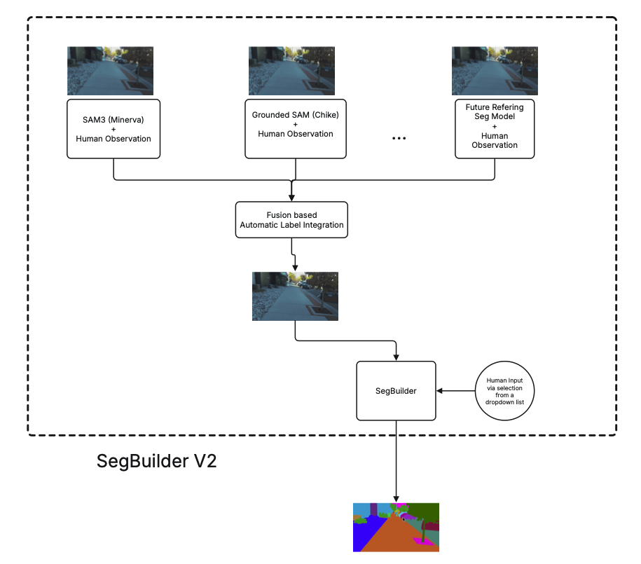
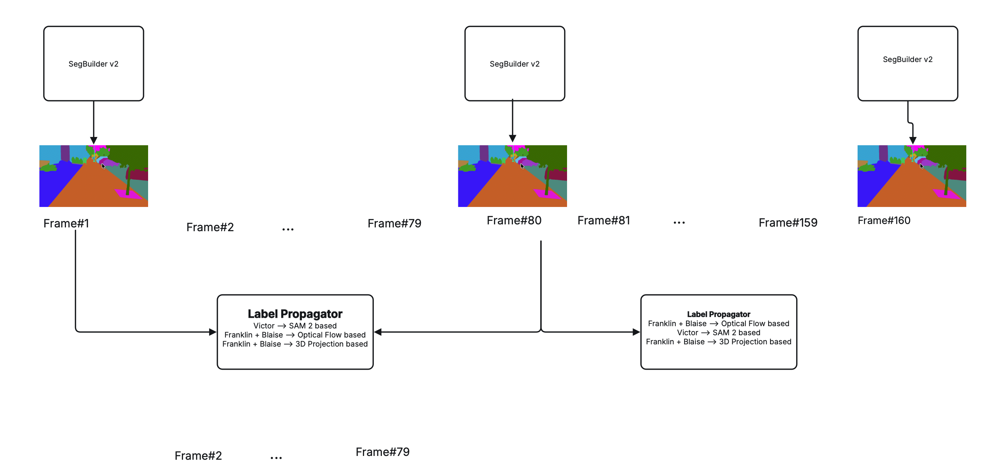

# Drake University CVRG (Fall26)
## outline of weekly research meeting notes
## Week#10 (November 13th, 2026)
- Chike demonstrated his integration of SAM3 and Grounded-SAM masks. He also measured the percentage coverage of pixels by his initial human-selected-objects based integration. Minverva was absent due to Music competition. Chike and I also discussed several other heuristics that he can experiment with and compare. I also suggested a Naive Bayes-based approach that would estimate the probability of a particular object being present given the presence of several other objects. For example:
(P(x_k = \text{road} \mid x_1 = \text{building}, x_2 = \text{car}, \ldots, x_{k-1} = \text{pole})). The idea is to leverage the co-occurrence relationships between different objects to predict the likelihood of another object being present.
- Had a discussion with Blaise. Franlin was absent. The idea is for Blaise to implement forward-only propagation while you implement backward-only propagation. I would like to investigate how each direction of propagation works independently.

## Week#10 (November 13th, 2026)
- Chike demonstrated his integration of SAM3 and Grounded-SAM masks. He also measured the percentage coverage of pixels by his initial human-selected-objects based integration. Minverva was absent due to Math competition.
- Franklin explained his method and Blaise watched it.

## Week#9 (November 6th, 2026)
- Chike and Minerva spent time integrating SAM3 and Grounded-SAM masks. They will compute the fraction of pixels covered by the integration of SAM3 and Grounded-SAM.
- Franklin will test his heuristic-based fusion approach for label transfer via optical flow.
- Blaise tried computing optical flow on a pair of adjacent images.
- Imran uploaded the .JSON file containing our finalized label dictionary with 101 objects.

  
## Week#8 (October 30th, 2026)
- Discussed the integration of SAM3 and Grounded-SAM masks with Chike and Minerva. Both will independently create their own mappings of objects for which SAM3 or Grounded-SAM works best. They will then take the union of these two dictionaries, where the keys will be object names and the values will indicate SAM3, Grounded-SAM, or both.
- Franklin tried optical-flow-based label transfer. Good job!
- Blaise joined the group. Explained the two sub-projects to him.

## Week#7 (October 23th, 2026)
- Discussed the integration of SAM3 and Grounded-SAM masks with Chike and Minerva. Both will independently create their own mappings of objects for which SAM3 or Grounded-SAM works best. We will then take the union of these two dictionaries, where the keys will be object names and the values will indicate SAM3, Grounded-SAM, or both.

- Discussed simple optical-flow-based label propagation with Franklin, Victor, and Chike. Franklin and Victor will propagate labels from one frame to the next using optical flow, computed using OpenCV's implementation. Minerva has prepared a sample sequence in which the two end frames have semantic labels generated by SAM3. We will use this sequence to experiment with the label propagation algorithm.

## Week#6 (October 14th, 2026)
- Chike and Minerva finished Grounded SAM and SAM 3 performance evaluations
  - Both computed precision-recall

## Week#5 (October 9th, 2026)
- Grounded SAM and SAM 3 performance evaluation
  - Discussed precision-recall metric calculation with Chike, Minerva, and Victor

## Week#4 (October 2nd, 2026)
- Presentation in front of QDU students and visitors. The presentation was photographed and video-recorded by Drake staff.
  - Reza provided a broad overview of the research work.
  - Chike presented the Grounded SAM results.
  - Minerva presented the SAM 3 results.
 
## Week#3 (Sep 25th, 2026)
- [SAM 3 python notebook for experiments](https://github.com/alimoorreza/DrakeUniversityCVRG_Fall26/blob/main/scripts/sam3_inference_kaggle.ipynb)
  - SAM 3 provides image segmentation with the given labels. While it can group a set of pixels into a homogeneous region remarkably well, it can also assign names or semantic labels to those regions.

## Week#2 (Sep 18th, 2026)
- [Segment Anything (SAM) python notebook for experiments](https://github.com/alimoorreza/DrakeUniversityCVRG_Fall26/blob/main/scripts/sam.ipynb)
  - SAM 1 provides image segmentation with unknown labels. While it can group a set of pixels into a homogeneous region remarkably well, it lacks the capability to assign names or semantic labels to those regions.
- [BLV Sidewalk dataset](https://github.com/Shohan29531/BLV-Road-Nav-Accessibility)
  - [The dataset's main contributors from Drake are Elena and Reza. The official research paper was published at ACM ASSETS ’24.](https://dl.acm.org/doi/abs/10.1145/3663548.3688538)
- References:
  - [SAM1](https://github.com/facebookresearch/segment-anything)
  - [SAM2](https://github.com/facebookresearch/sam2)
  - [SAM3](https://github.com/facebookresearch/sam3)
